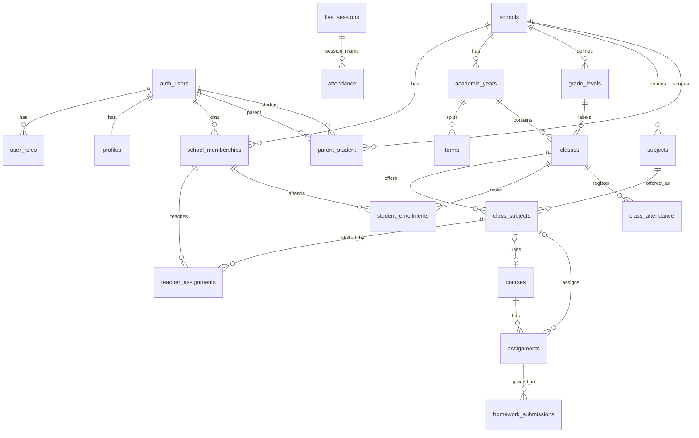

# Multi-school architecture

The schema and Row Level Security for this design are in `supabase/migrations/20261125143000_multi_school_schema.sql` and `supabase/migrations/20261125143100_multi_school_record_scope.sql`. Applying them, and rolling them back, is described in [MULTI_SCHOOL_MIGRATION.md](MULTI_SCHOOL_MIGRATION.md). Those files do not assign existing users to a school.

Inspected schema: `supabase/migrations`, from `20260302105135` through `20260529165044`. Nothing below is deployed until those two migrations are applied on a database.

## What exists today

There is one tenant. Every authenticated user who can pass a policy can see published courses, and `admin` can manage rows on every table that checks `has_role(..., 'admin')`.

| Concern | Where it lives now | Limit |
| --- | --- | --- |
| Global role | `app_role` enum and `user_roles` (`student`, `parent`, `teacher`, `admin`). Unique `(user_id, role)`, so one person can hold more than one global role. | `admin` is platform-wide. There is no school. |
| Signup | Latest `handle_new_user` (`20260529160934`) stores only `student` or `parent` from signup metadata. Any other value, including `teacher` and `admin`, is stored as `student`. | Teachers and platform admins are not created by public signup. |
| Profile | `profiles` (one row per auth user, including `student_code`) plus `student_profiles`, `parent_profiles`, `teacher_profiles`. | `student_profiles.school_name` and `class_level` are free text. They are not foreign keys. |
| Parent and child | `parent_student (parent_id, student_id)`. `children_info` is a parent's private note and may point at `linked_student_id`. | The link is not tied to a school. A parent inserts the link for themselves. |
| Teaching | `courses.teacher_id`, `courses.subject`, `courses.level`. `course_enrollments` lets a student enroll in any published course. | A course is owned by a teacher, not a school or a class. |
| Homework and grades | `assignments.course_id`. `homework_submissions.grade` and `status`. | The grade is the submission. There is no separate grades ledger. |
| Attendance | `attendance` for a `live_sessions` row and a `course_id`. | It is session attendance, not a class register. |
| Isolation | Policies compare `auth.uid()` to a teacher, a student, a parent link, or `has_role(admin)`. | Several policies are wider than a school boundary. `profiles` select is open to every authenticated user. `teacher_profiles` select is open to every authenticated user. Those gaps stay until a later reviewed migration. This design does not close them by itself. |

## Roles

Keep the global enum as it is.

| Global role | Meaning after this design |
| --- | --- |
| `student` | The account can hold a student membership. |
| `parent` | The account can be linked to children and can hold parent memberships. |
| `teacher` | The account can hold teacher memberships. Public signup still cannot create this role. |
| `admin` | Platform administrator. Not a school membership. |

Do not add `school_admin` to `app_role`.

A school administrator is `school_memberships.membership_role = 'school_admin'` for one school. A person may administer school A and teach at school B. A new global role would grant school administration on every school, which is the problem `admin` already has. Membership is the permission.

`admin` stays the platform administrator: create a school, suspend a school, appoint the first school administrator, and read school rows for support. A platform administrator does not grade, mark a class register, or place a student in a class unless that person also has the matching membership.

## Who may belong to more than one school

| Person | Rule |
| --- | --- |
| Platform administrator | No membership is required to oversee schools. |
| School administrator | One active `school_admin` membership per school they are appointed to. More than one school is allowed. |
| Teacher | One active `teacher` membership per school they work in. More than one school is allowed. A class assignment is a further row, not the membership itself. |
| Student | At most one **active** student membership on the whole platform. Older memberships stay as `left` or the class enrollment stays `completed`, so a student can have attended more than one school over time. |
| Parent | One parent membership per school where they have an active link to a child. More than one school is allowed. The parent does not pick the school. The child's active membership does. |

A person who is a parent and a teacher at the same school has two membership rows. The global `user_roles` row still says what kind of account they have.

## Ownership and operations

| Record | Owner | Who creates it | Who changes it |
| --- | --- | --- | --- |
| `schools` | The school row | Platform administrator | Platform administrator suspends it. School administrators of that school edit the name and slug. |
| `school_memberships` | The school | School administrator of that school, or a platform administrator appointing the first school administrator. A student may insert only a `pending` student membership. | School administrator activates, suspends, or ends it. The user cannot set their own role to `teacher` or `school_admin`. |
| `academic_years` | The school | School administrator | School administrator. One year per school has status `current`. |
| `terms` | The academic year, and the school | School administrator | School administrator. Dates sit inside the year and do not overlap inside that year. |
| `grade_levels` | The school | School administrator | School administrator. Names are school-defined because `class_level` is free text today. |
| `classes` | The school and one academic year | School administrator | School administrator. A class is a grade level plus a name for that year. |
| `subjects` | The school | School administrator | School administrator. |
| `class_subjects` | The class | School administrator | School administrator. Optional `course_id` points at an existing course. |
| `teacher_assignments` | The class subject | School administrator | School administrator. The teacher must already have an active teacher membership at that school. |
| `student_enrollments` | The class | School administrator | School administrator withdraws or completes it. This is how a student joins a class. |
| `parent_student` | The family link | Existing link flow, narrowed: the parent proves the child with `profiles.student_code`, the child already has an active student membership, and the link stores that school. | School administrator of that school, or the parent, can revoke the link. Revoking it does not delete history. |
| Courses, homework, grades, live-session attendance | The course today (`courses.teacher_id`) | Unchanged until a later migration sets `school_id` | See the RLS section. New class homework uses `assignments.class_subject_id`. |

Teachers are assigned only by `teacher_assignments`. `courses.teacher_id` remains the course author. It does not place a teacher on a class.

Students join a class only through `student_enrollments`. Self-serve `course_enrollments` stays for a course that has no school (`school_id` null) until that policy is replaced. A course linked from `class_subjects` is not an open catalog: enrollment in that course follows the class roster.

Parents are linked to children through `parent_student`. `children_info` stays a private note for the parent. It is not the school roster.

Academic years are managed by the school administrator. Closing a year sets `status = closed`. It does not delete classes or enrollments. The next year starts empty. Moving a student up a grade is a later explicit action, not part of closing the year.

Classes and subjects meet in `class_subjects`. A class has many subjects. A subject is offered in many classes. A teacher assignment points at one class subject, not at the whole class, so a teacher of mathematics does not automatically see French grades.

## ERD

`auth_users` is `auth.users`. `courses`, `assignments`, `homework_submissions`, `attendance`, and `live_sessions` already exist.

## Table definitions

New tables use `uuid` primary keys, `timestamptz` stamps, and `school_id` on every school-owned row so policies do not have to join through five tables. Status and role values are `text` with a `check` constraint, not a new Postgres enum, so a later change does not rewrite `app_role`.

### schools

| Column | Type | Constraint |
| --- | --- | --- |
| id | uuid | primary key, default `gen_random_uuid()` |
| name | text | not null |
| slug | text | not null, unique |
| status | text | not null, default `active`, check `active` or `suspended` |
| created_by | uuid | null, references `auth.users` |
| created_at, updated_at | timestamptz | not null, default `now()` |

### school_memberships

| Column | Type | Constraint |
| --- | --- | --- |
| id | uuid | primary key |
| school_id | uuid | not null, references `schools` on delete cascade |
| user_id | uuid | not null, references `auth.users` on delete cascade |
| membership_role | text | not null, check `school_admin`, `teacher`, `student`, `parent` |
| status | text | not null, default `pending`, check `pending`, `active`, `suspended`, `left` |
| invited_by | uuid | null, references `auth.users` |
| started_on, ended_on | date | `ended_on` null while active |
| created_at, updated_at | timestamptz | not null |

Unique `(school_id, user_id, membership_role)`.

Partial unique index on `user_id` where `membership_role = 'student'` and `status = 'active'`. That is the one-active-school rule for students.

A teacher or school administrator membership may be inserted only when `user_roles` already contains `teacher` or when a platform administrator is appointing a `school_admin`. The check belongs in the insert policy and a trigger, not in the client.

### academic_years

| Column | Type | Constraint |
| --- | --- | --- |
| id | uuid | primary key |
| school_id | uuid | not null, references `schools` |
| name | text | not null |
| starts_on, ends_on | date | not null, `ends_on > starts_on` |
| status | text | not null, default `planned`, check `planned`, `current`, `closed` |

Unique `(school_id, name)`.

Partial unique index on `school_id` where `status = 'current'`.

### terms

| Column | Type | Constraint |
| --- | --- | --- |
| id | uuid | primary key |
| school_id | uuid | not null, references `schools` |
| academic_year_id | uuid | not null, references `academic_years` |
| name | text | not null |
| starts_on, ends_on | date | not null, `ends_on > starts_on` |
| sort_order | integer | not null |

Unique `(academic_year_id, name)`.

`school_id` must match the year's school. A trigger rejects a term outside the year and a term that overlaps another term of the same year. Do not depend on `btree_gist`; that extension is not in the current migrations.

### grade_levels

| Column | Type | Constraint |
| --- | --- | --- |
| id | uuid | primary key |
| school_id | uuid | not null, references `schools` |
| name | text | not null |
| sort_order | integer | not null |

Unique `(school_id, name)`.

### classes

| Column | Type | Constraint |
| --- | --- | --- |
| id | uuid | primary key |
| school_id | uuid | not null, references `schools` |
| academic_year_id | uuid | not null, references `academic_years` |
| grade_level_id | uuid | not null, references `grade_levels` |
| name | text | not null |
| status | text | not null, default `active`, check `active` or `archived` |

Unique `(academic_year_id, grade_level_id, name)`.

The year and the grade level must belong to `school_id`.

### subjects

| Column | Type | Constraint |
| --- | --- | --- |
| id | uuid | primary key |
| school_id | uuid | not null, references `schools` |
| name | text | not null |
| code | text | null |

Unique `(school_id, name)`.

### class_subjects

| Column | Type | Constraint |
| --- | --- | --- |
| id | uuid | primary key |
| school_id | uuid | not null |
| class_id | uuid | not null, references `classes` |
| subject_id | uuid | not null, references `subjects` |
| course_id | uuid | null, references `courses` |

Unique `(class_id, subject_id)`.

The class, the subject, and the course (when set) must belong to the same school. A course with `school_id` null cannot be linked here. That keeps the legacy catalog out of a class until a human assigns it.

### teacher_assignments

| Column | Type | Constraint |
| --- | --- | --- |
| id | uuid | primary key |
| school_id | uuid | not null |
| class_subject_id | uuid | not null, references `class_subjects` |
| membership_id | uuid | not null, references `school_memberships` |
| is_primary | boolean | not null, default true |
| starts_on, ends_on | date | `ends_on` null while current |

Unique `(class_subject_id, membership_id)`.

Partial unique index on `class_subject_id` where `is_primary` and `ends_on` is null.

The membership must be an active `teacher` membership of `school_id`.

### student_enrollments

| Column | Type | Constraint |
| --- | --- | --- |
| id | uuid | primary key |
| school_id | uuid | not null |
| academic_year_id | uuid | not null |
| class_id | uuid | not null, references `classes` |
| membership_id | uuid | not null, references `school_memberships` |
| status | text | not null, default `active`, check `active`, `withdrawn`, `completed` |
| enrolled_on | date | not null |
| withdrawn_on | date | null |

Unique `(class_id, membership_id)`.

Partial unique index on `(academic_year_id, membership_id)` where `status = 'active'`. One active class per student per year.

The membership must be an active `student` membership of `school_id`.

### class_attendance

This is the class register. It does not replace `attendance`, which remains live-session attendance.

| Column | Type | Constraint |
| --- | --- | --- |
| id | uuid | primary key |
| school_id | uuid | not null |
| class_id | uuid | not null, references `classes` |
| membership_id | uuid | not null, the student membership |
| session_date | date | not null |
| status | text | not null, check `present`, `absent`, `late`, `excused` |
| marked_by | uuid | not null, references `school_memberships` |
| notes | text | null |
| marked_at | timestamptz | not null, default `now()` |

Unique `(class_id, membership_id, session_date)`.

`marked_by` must be an active teacher assignment on a subject of that class. A school administrator can read the register and does not mark it.

### Columns added with the scope migration

`20261125143100_multi_school_record_scope.sql` adds these columns as null. It does not backfill them.

| Table | Column | Purpose |
| --- | --- | --- |
| `courses` | `school_id uuid null` | Null means the existing shared catalog. A class link requires a non-null school. |
| `assignments` | `class_subject_id uuid null` | Class homework. `course_id` stays for current rows. |
| `parent_student` | `school_id uuid null`, `relationship text`, `status text` | Scope the existing family link. `relationship` is `mother`, `father`, `guardian`, or `other`. `status` is `active` or `revoked`. |

Do not add a second grades table. `homework_submissions.grade` is the grade. Class grades are the submissions whose assignment has `class_subject_id`.

## Relationships

- A school has many memberships, years, grade levels, and subjects.
- A year has many terms and many classes.
- A class belongs to one year and one grade level.
- A class subject belongs to one class and one subject, and may point at one course.
- A teacher assignment belongs to one class subject and one teacher membership.
- A student enrollment belongs to one class and one student membership.
- A parent link belongs to one parent user, one student user, and, once backfilled, one school.
- Deleting a school cascades memberships, years, classes, and rosters. It does not delete `auth.users`, `profiles`, or `parent_student` history. `parent_student.school_id` uses `on delete restrict` so a school with family links cannot disappear silently.
- Deleting a user cascades memberships and enrollments that reference them.

## RLS policy design

Helpers are `stable`, `security definer`, and `set search_path = public`. They read membership and role tables so policies do not recurse.

- `is_platform_admin(uid)` is true when `user_roles` has `admin` for `uid`.
- `active_membership(uid, school_id, role)` is true when that membership exists with `status = active`.
- `teaches_class_subject(uid, class_subject_id)` is true when the user has a current teacher assignment on that row.
- `student_in_class(uid, class_id)` is true when the user has an active student enrollment in that class.
- `parent_of(uid, student_user_id)` is true when `parent_student` has an active link.

Platform administrators pass every school read policy below. They do not pass teacher-only write policies.

New tables enable RLS and grant `select`, `insert`, `update` to `authenticated` only where a policy also matches. No `for all` policy with `using (true)`.

### School isolation

| Policy | Command | Predicate |
| --- | --- | --- |
| Platform admin inserts schools | insert | `is_platform_admin(auth.uid())` |
| Members read their schools | select | active membership in `schools.id`, or platform admin |
| School admin updates their school | update | active `school_admin` membership, and cannot change `status` to `suspended` |
| Platform admin updates any school | update | `is_platform_admin` |

No delete policy. Suspension is the status change.

Every later table repeats: `school_id` matches a school the caller belongs to, or the caller is a platform admin. A membership of school A does not satisfy school B.

### Class isolation

| Who | Read | Write |
| --- | --- | --- |
| School administrator | Classes, subjects, class subjects, and rosters of their school | Insert and update those rows |
| Teacher | Classes where they have a current assignment, and the roster of those classes | No class or roster insert |
| Student | The class of their active enrollment, its subjects, and the names of teachers assigned there | No |
| Parent | The class of each actively linked child | No |
| Platform admin | Read | No class write |

Students do not receive a list of other students' grades through the class read. The roster select for a student returns their own enrollment row. Teachers and school administrators of that school can read the roster.

### Teacher assignments

| Policy | Predicate |
| --- | --- |
| School admin manages assignments in their school | active `school_admin` for `school_id` |
| Teacher reads their own assignments | membership `user_id = auth.uid()` |
| Student and parent read assignments for the child's class | `student_in_class` or `parent_of` a student in that class |
| Teacher insert | No policy. The school administrator inserts the row. |

### Student records

Student records are `student_profiles`, the student membership, and the class enrollment.

| Who | Access |
| --- | --- |
| Student | Own `student_profiles` and own enrollment |
| Parent | `student_profiles` and enrollment of actively linked children |
| Teacher | Those rows for students in a class they are assigned to |
| School administrator | Those rows for active student memberships of their school |
| Platform admin | Read |

`student_profiles` already has policies. The later migration adds school-scoped policies and removes the paths that ignore the school. Until that migration, the current policies remain. Do not stack a permissive school policy on top of an open one and call it isolation.

### Parent-child relationships

| Policy | Predicate |
| --- | --- |
| Parent reads and revokes own links | `parent_id = auth.uid()` and, on insert, the student code resolves to a user with an active student membership |
| Student reads links that name them | `student_id = auth.uid()` |
| School admin reads and revokes links for their school | `school_id` matches and the student membership is in that school |
| Parent insert | A security definer function checks `student_code`, checks the student membership, writes `school_id`, and inserts the parent membership if it is missing. Direct insert of another school's id fails the `with check`. |
| Platform admin | Read |

`children_info` stays parent-owned. Teachers do not gain a new read on it in this design. The current "teachers view linked children" policy is one of the policies a later migration must narrow to an assigned class.

### Courses

| Course | Who reads | Who writes |
| --- | --- | --- |
| `school_id` null (legacy catalog) | Keep today's policies until the follow-up migration | Keep today's policies |
| `school_id` set | School members of that school, plus a parent of an enrolled student | An active teacher membership of that school may insert a course with their `teacher_id`. They may update a course they author. A school administrator of that school may update any course of the school. A platform admin may read, not author, unless they also have a teacher membership. |

A course with a school cannot be enrolled through the open "students enroll in published courses" policy. The follow-up migration adds `school_id is null` to that insert check. Class enrollment creates the `course_enrollments` row when `class_subjects.course_id` is set.

### Homework

`assignments` with `class_subject_id` null keep today's course policies.

`assignments` with `class_subject_id` set:

| Who | Access |
| --- | --- |
| Assigned teacher of that class subject | Insert and update the assignment. Read submissions. Update `grade`, `status`, and `teacher_comment`. |
| School administrator of the school | Read assignments and submissions. They do not grade. |
| Enrolled student | Read the assignment. Insert a submission with `user_id = auth.uid()`. Read own submission. No update of `grade`. |
| Parent of that student | Read the assignment and that child's submission. |
| Anyone else | No row |

The current student insert on `homework_submissions` checks only `user_id`. The follow-up migration must also require an active class enrollment or a course enrollment, and must reject a student setting `grade` or `status` other than `pending`. That gap is already recorded in `SECURITY.md`. This design does not leave it as the target policy.

### Grades

The grade is `homework_submissions.grade`.

| Who | Access |
| --- | --- |
| Student | Select own grade |
| Parent | Select the linked child's grade |
| Assigned teacher | Update the grade for submissions in their class subject or their course |
| School administrator | Select grades in the school. No update. |
| Platform admin | Select |

There is no insert of a grade without a submission.

### Attendance

Live-session `attendance` keeps today's teacher-of-the-course rule until `courses.school_id` is enforced. The follow-up adds: the course's school matches, and the student is enrolled in that course or in a class linked to it. Parents keep select on a linked child. Students keep select on themselves. School administrators select rows for their school's courses.

`class_attendance`:

| Who | Access |
| --- | --- |
| Assigned teacher of the class | Insert and update the register for students enrolled in that class |
| School administrator | Select the register. They do not mark it unless they also have a teacher assignment. |
| Student | Select own row |
| Parent | Select the linked child's row |
| Platform admin | Select |

`marked_by` must be the caller's teacher membership.

## Index recommendations

| Index | Why |
| --- | --- |
| `school_memberships (school_id, status)` | Member lists and RLS lookups |
| `school_memberships (user_id, status)` | "Which schools is this person in?" |
| Unique `(school_id, user_id, membership_role)` | One row per role per school |
| Unique `user_id` where student and active | One current school for a student |
| Unique `academic_years.school_id` where `status = current` | One current year |
| `terms (academic_year_id, starts_on)` | Calendar order |
| `classes (school_id, academic_year_id)` | Year roster |
| Unique `(academic_year_id, grade_level_id, name)` on classes | No duplicate class names |
| `class_subjects (class_id)` and `(subject_id)` | Offerings |
| `teacher_assignments (membership_id)` and unique primary per class subject | "My classes" and one primary teacher |
| `student_enrollments (class_id, status)` | Roster |
| Unique `(academic_year_id, membership_id)` where active | One active class per year |
| `parent_student (student_id)` and `(school_id, student_id)` | Parent reads and school admin reads |
| `class_attendance (class_id, session_date)` | Daily register |
| `courses (school_id)` after that column exists | School catalog |
| `assignments (class_subject_id)` after that column exists | Class homework |
| `homework_submissions (assignment_id, user_id)` | One student's work. Add a unique constraint if the product allows only one file per student per assignment. Today it does not have that unique key; do not add it in the same migration as the backfill without checking duplicate rows. |

## Existing-data migration plan

`20261125143000` adds the tables, checks, triggers, helpers, and policies. `20261125143100` adds the nullable columns and replaces the catalog policies so a row with a school cannot be read through the old open policies. Neither file inserts a school, a membership, or a school id onto an existing course, assignment, or parent link.

The following backfill is not in those files. It would invent a school for blank names and for every teacher. Do not run it unless a later review accepts that assignment.

1. Create schools from distinct trimmed `student_profiles.school_name` values that are not empty. Do not merge names that differ by case, accent, or abbreviation. Do not create a school for a null or blank name.
2. Insert one active student membership per student whose `school_name` matches one of those schools. If the partial unique index rejects a second row, keep the first and record the user id.
3. Do not invent a teacher membership from a course title. A school administrator appoints teachers.
4. For each `parent_student` row, leave `school_id` null until the parent calls `link_parent_by_student_code` or the student has an active membership and a reviewed job sets the matching school.
5. Do not copy `user_roles.admin` into `school_admin`.
6. Leave `student_profiles.school_name` and `class_level` in place.
7. Backfill `courses.school_id` only when that course's teacher has exactly one teacher membership. Skip the rest and list those course ids.

## Rollback

Operational steps, including the previous policy statements, are in [MULTI_SCHOOL_MIGRATION.md](MULTI_SCHOOL_MIGRATION.md). Roll back with a new forward migration. Do not edit a migration that has already run, and do not rewrite git history.

## Out of scope

- A backfill that assigns existing people or courses to a school.
- A new global role.
- Official curriculum lists.
- Automatic promotion to the next grade.
- Merging duplicate school names.
- Closing the existing open `profiles` select policy. That remains a known gap.
